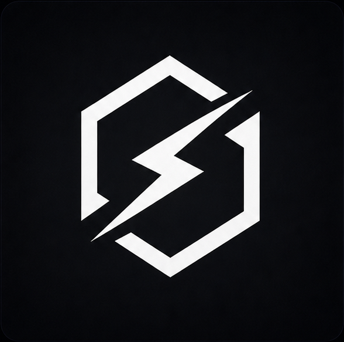

<p align="center">
  
</p>

<h1 align="center">Grom Client</h1>

<p align="center">
  Бесплатный лаунчер Minecraft с открытым кодом: моды, шейдеры и ресурспаки с Modrinth, сборки, ИИ-помощник, мессенджер и игра с друзьями.
</p>

<p align="center">
  <a href="https://gromclient.devs.li">Сайт</a> ·
  <a href="../../releases/latest">Скачать</a> ·
  <a href="PRIVACY.md">Конфиденциальность</a> ·
  <a href="docs/DEVELOPMENT.md">Для разработчиков</a>
</p>

---

## Скачать

Последняя версия всегда в **[Releases](../../releases/latest)** → файл `Grom-Client-Setup-x.y.z.exe` (Windows 10/11, x64).

Установщики собираются **автоматически на серверах GitHub** из кода этого репозитория (см. [`.github/workflows/release.yml`](.github/workflows/release.yml)). Вручную собранные файлы в релизы не загружаются.

## Как проверить, что файл настоящий

1. **Контрольная сумма.** Рядом с установщиком лежит `SHA256SUMS.txt`. Проверь в PowerShell:
   ```powershell
   Get-FileHash .\Grom-Client-Setup-1.5.2.exe -Algorithm SHA256
   ```
   Значение должно совпасть с тем, что в `SHA256SUMS.txt`.
2. **Аттестация GitHub.** Она доказывает, что файл собран GitHub Actions из этого репозитория, а не подменён:
   ```bash
   gh attestation verify Grom-Client-Setup-1.5.2.exe --repo B0DR0DEV/Grom-Client
   ```
3. Качай только с [сайта](https://gromclient.devs.li) или со страницы **Releases** этого репозитория. Любые другие «сборки Grom Client» — не наши.

### Почему Windows пишет «Неизвестный издатель»

Пока установщик не подписан сертификатом, SmartScreen показывает синее окно. Нажми **«Подробнее» → «Выполнить в любом случае»**. Мы подали заявку на бесплатную подпись для open-source проектов; когда её одобрят, предупреждение исчезнет.

## Возможности

- Любые версии Minecraft — от старых альф до свежих снапшотов; Vanilla и Fabric
- Моды, ресурспаки, шейдеры и сборки из официального **Modrinth** в один клик
- Автоматическая загрузка нужной Java
- ИИ-помощник: ответит на вопросы и подберёт сборку под тему
- Мессенджер: общий чат, личные сообщения, голосовые звонки
- Игра с друзьями: туннель, обмен сборкой коротким кодом
- FPS Boost: подбор ОЗУ, аргументов Java, модов оптимизации и видеокарты
- Редактор скинов с 3D-просмотром, бэкап миров, скриншоты
- Диагностика вылетов, проверка модов, восстановление файлов
- Перенос настроек и миров из других лаунчеров

## Наши моды

- **Grom Visuals** — меню, HUD, редактор прицела, косметика (Fabric 1.21.11)
- **TrustNoOne** — кооперативный хоррор для друзей (Fabric 1.21.11)

## Конфиденциальность

Что лаунчер отправляет в сеть и зачем — подробно в [PRIVACY.md](PRIVACY.md). Пароль от аккаунта Microsoft лаунчер не видит: вход идёт на официальной странице Microsoft в твоём браузере.

## Нашёл баг или уязвимость?

- Баги и идеи — в [Issues](../../issues).
- Уязвимости — пожалуйста, не публично: напиши через вкладку **Security → Report a vulnerability**.

## Лицензия

[MIT](LICENSE). Grom Client не является официальным продуктом Mojang или Microsoft. Minecraft — товарный знак Mojang AB.
